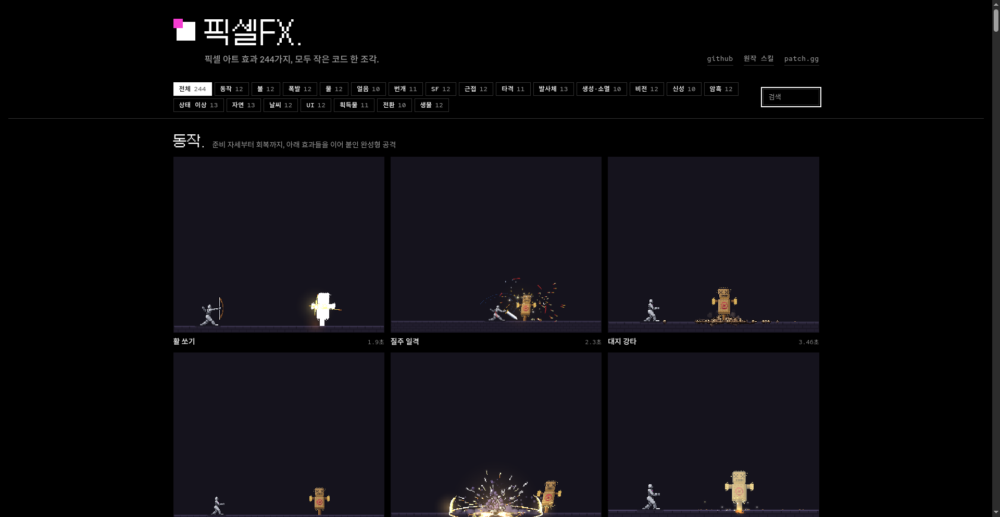
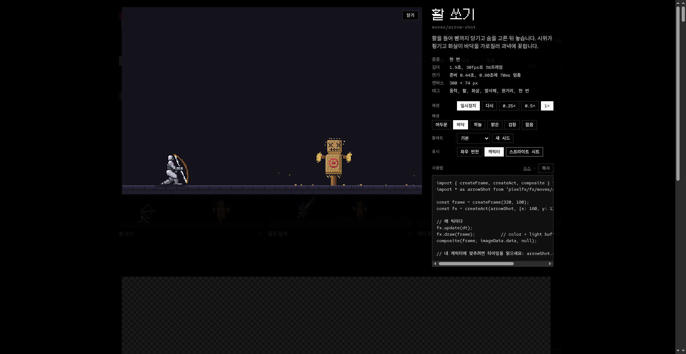

# 픽셀FX 한글판

[patch-gg/pixelfx](https://github.com/patch-gg/pixelfx)([갤러리 원본](https://patch-gg.github.io/pixelfx/))의 한국어 로컬라이즈 버전입니다.

**픽셀 아트 효과 244가지, 모두 작은 코드 한 조각.** 불, 폭발, 마법, 날씨, UI, 획득물, 생물까지. 갤러리에서 실시간으로 재생하고, 팔레트를 바꾸고 좌우로 반전해 보고, 브라우저 게임에 코드 그대로 넣거나, 아무 엔진에서나 쓸 스프라이트 시트로 내보낼 수 있습니다. 원본 저장소에는 깐깐한 픽셀 아티스트처럼 새 효과를 만들어 주는 Claude Code 스킬도 들어 있습니다: 초안, 렌더, 눈으로 확인, 다듬기.

**[한글판 갤러리 열기](https://sigco3111.github.io/pixelfx-ko/)** · [원본 영문 README](README.en.md)

## 한글화 범위

- 갤러리 UI 전체: 헤더, 카테고리 칩(21개), 섹션 제목과 소개, 검색창, 상세 패널, 조작 버튼
- 244개 효과의 **이름·설명·태그** 한국어 번역
- **한글·영어 동시 검색**: "번개"와 "lightning" 둘 다 찾을 수 있습니다
- 효과 ID(`moves/arrow-shot` 등)와 코드, 파일 구조는 원본과 동일하게 유지

## 실행 화면





## 빠른 시작

로컬에서 갤러리를 띄우려면:

```bash
git clone https://github.com/sigco3111/pixelfx-ko.git
cd pixelfx-ko
npm ci
node tools/serve.mjs
```

브라우저에서 `http://localhost:3000`을 열면 한글 갤러리가 뜹니다.

## 효과 사용하기

**브라우저 게임**에서 (canvas, Phaser, PixiJS, Kaplay, three.js) 코드를 그대로 씁니다. 의존성 없음.

```js
import { createFrame, clearFrame, createFx, composite } from "pixelfx";
import * as frostNova from "pixelfx/fx/ice/frost-nova";

const frame = createFrame(320, 180);                 // 게임의 픽셀 해상도
const img = new ImageData(320, 180);
const fx = createFx(frostNova, { x: 160, y: 140 });  // flip, angle, seed, palette, light... 도 가능

function tick(dt) {
  fx.update(dt);
  clearFrame(frame);
  fx.draw(frame, "back");                            // 캐릭터 뒤
  drawCharacters();
  fx.draw(frame, "front");
  composite(frame, img.data, backgroundColor);       // 색 버퍼 위에 빛 버퍼를 더함
  ctx.putImageData(img, 0, 0);                       // image-rendering: pixelated 로 확대
}
```

**아무 엔진에서나** (Godot, Unity, GameMaker, Defold, LÖVE, Bevy) 스프라이트 시트로 내보냅니다:

```bash
node tools/render.mjs ice/frost-nova --sheet
```

갤러리의 상세 패널에서도 **스프라이트 시트** 버튼으로 바로 PNG+JSON을 만들 수 있습니다.

자세한 사용법·연기(acting) 시스템·직접 만드는 방법·내부 구조는 [원본 영문 README](README.en.md)를 참고하세요. 원문의 예제와 도구는 그대로 동작합니다.

## 기술 스택

- 순수 JavaScript + Canvas `ImageData`, 빌드는 esbuild 번들 하나
- GitHub Actions(`.github/workflows/gallery.yml`)가 push마다 검사(`tools/check.mjs`) 후 갤러리를 빌드해 GitHub Pages에 배포
- 한글 번역 사전: `gallery/ko.js` (카테고리 21 + 태그 512 + 효과 244)

## 라이선스와 크레딧

- 원본: [patch-gg/pixelfx](https://github.com/patch-gg/pixelfx), 코드와 효과 모두 **MIT** (상업적 사용 가능). 제작: [Patch](https://patch.gg).
- 일부 효과는 Hugo Duprez(Sprite Fusion)와 Hollow Crown의 MIT 소스를 각색 ([NOTICE.md](NOTICE.md)).
- 원본 갤러리의 Patch Pixel 폰트는 Patch의 전용 폰트라 MIT에 포함되지 않아, 한글판에서는 **SIL 오픈 폰트 라이선스(OFL 1.1)의 [Galmuri11](https://github.com/quiple/galmuri)** (© Lee Minseo)로 교체했습니다. 본문 폰트는 Google Fonts의 Noto Sans KR. 자세한 내용은 [gallery/fonts/NOTICE.md](gallery/fonts/NOTICE.md).
- 한글화 작업 자체는 원본의 MIT 라이선스를 따릅니다.
